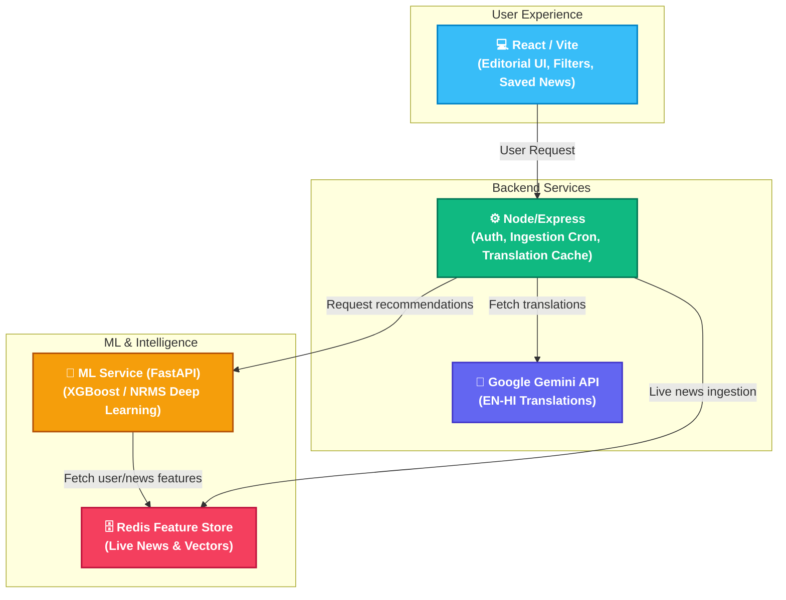
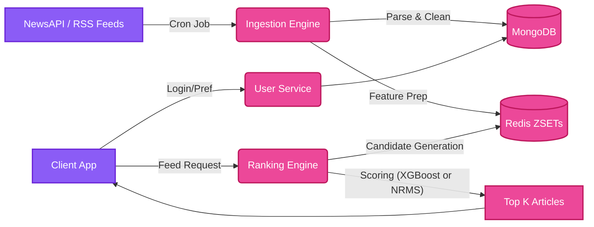

# Jagrit — Personalized AI News Platform

Jagrit is a fully functional, personalized bilingual news platform that combines real-time news ingestion with machine learning to deliver a curated "For You" experience. Inspired by premium editorial websites (like The Hindu or New York Times), Jagrit uses a microservices architecture featuring a React frontend, a Node.js API backend, and a Python-based ML recommendation engine.

## 🚀 Key Features

* **Real-time News Ingestion**: Automatically aggregates live breaking news from **NewsAPI** and premium **RSS Feeds** (Times of India, The Hindu, BBC, CNBC), extracting real high-quality images and full summaries.
* **ML-Powered "For You" Feed**: Uses an **XGBoost** ranking model trained on Microsoft's MIND dataset to serve personalized top stories based on the user's reading history and category preferences.
* **Bilingual Experience (AI Translation)**: Integrates the **Google Gemini (1.5 Flash) API** to instantly translate English news headlines and abstracts into Hindi. Translations are intelligently cached in **MongoDB** to guarantee fast load times and minimize API costs.
* **Hybrid Feed Layout**: The UI splits the feed into a premium **For You** hero section (top 6 ML-ranked articles) and a **Global News** grid for trending worldwide stories.
* **Category Filtering**: A sleek sidebar allows users to filter the entire feed by specific topics (Politics, Technology, Business, Sports, etc.).
* **Saved News Archive**: Users can bookmark their favorite articles and access them later in a dedicated, personalized "Saved News" dashboard.
* **Zero-Downtime Microservices**: Designed to be deployed across Vercel (Frontend), Render (Backend), and a dedicated VM for the Python ML Engine + Redis.

---

## 🛠️ Technology Stack

### Frontend (Web)
* **React.js** (Vite): Fast, modern component-based UI.
* **Tailwind CSS**: Custom, responsive editorial-style design without bloated stylesheets.
* **React Router v6**: Client-side routing for seamless navigation.

### Backend (API & Ingestion)
* **Node.js & Express.js**: Handles user authentication (JWT), preferences, and live news fetching.
* **MongoDB (Mongoose)**: Primary database for user data, preferences, and translated text caching.
* **RSS Parser & Axios**: Used in the scheduled ingestion cron jobs to parse live news sources and fetch data.
* **Google Gemini API**: Powers the English-to-Hindi translation layer.

### ML & Recommendation Service
* **Python & FastAPI**: High-performance API serving the machine learning model.
* **XGBoost & Pandas**: The core ranking algorithm and feature engineering library.
* **Redis**: Acts as an ultra-fast, in-memory **Feature Store**. It holds the latest ingested news (`news:recent` ZSET and Hashes) and serves them instantly to the ML ranker.
* **Kafka** *(Architecture Support)*: Streams real MIND behavior logs to simulate production data.

---

## 🏗️ Architecture



## 🧩 Component Diagram


---

## ⚡ Quick Start (Local Development)

### Prerequisites
* Node.js (v18+)
* Python 3.9+
* Redis Server (running locally on port 6379)
* MongoDB (Local or Atlas URI)

### 1. Setup Backend
```bash
cd backend
npm install
# Create a .env file with MONGODB_URI, JWT_SECRET, GEMINI_API_KEY, NEWS_API_KEY, REDIS_URL
npm start
```

### 2. Setup ML Service
```bash
cd ml-service
python -m venv venv
source venv/bin/activate  # On Windows: venv\Scripts\activate
pip install -r requirements.txt
uvicorn app.main:app --reload --port 8000
```

### 3. Setup Frontend
```bash
cd web
npm install
# Create a .env file with VITE_API_URL=http://localhost:5000
npm run dev
```

---

## 🌐 Production Deployment Guide

Since Jagrit utilizes a microservices architecture, you can deploy the frontend and backend on serverless platforms (like Vercel and Render), while the ML service needs a dedicated environment.

### 1. Product Backend (Node.js)
* **Provider**: Render (Web Service)
* **Settings**:
  * Root Directory: `backend`
  * Build Command: `npm install`
  * Start Command: `npm start`
  * Env Vars: `MONGODB_URI`, `JWT_SECRET`, `GEMINI_API_KEY`, `NEWS_API_KEY`, `REDIS_URL` (From Aiven/Upstash), and `ML_SERVICE_URL`.

### 2. Web Frontend (React)
* **Provider**: Vercel
* **Settings**: 
  * Root Directory: `web`
  * Framework Preset: Vite
  * Env Vars: `VITE_API_URL` pointing to your deployed Render backend.

### 3. ML Service (Python FastAPI)
* **Provider**: AWS EC2, DigitalOcean, or Render Docker Service.
* Ensure you connect it to the same remote `REDIS_URL` used by the Node.js backend so the ML engine can access the live news ingested by the backend.
